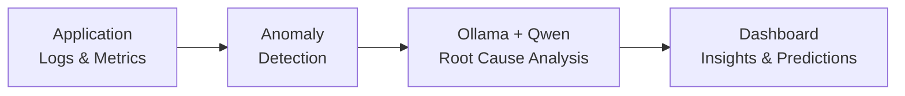

<div align="center">


<br/>

<a href="https://www.linkedin.com/in/aditya-shukla-606a40415"></a>
<a href="https://github.com/adityx-lab"></a>


</div>

---

```bash
┌──(aditya㉿kanpur)-[~]
└─$ whoami
Aditya Shukla — B.Tech CSE @ PSIT Kanpur (Final Year)

┌──(aditya㉿kanpur)-[~]
└─$ cat now.txt
→ Shipping TraceSage, my final year project (AI root cause analysis)
→ Grinding DSA in Java for placements
→ Looking for an SDE / Backend / Full Stack internship

┌──(aditya㉿kanpur)-[~]
└─$ cat philosophy.txt
Build. Break. Debug. Repeat.
```

---

## `01` // WHAT I DO

I build full-stack products and wire real AI into them: not a chatbot bolted on at the end, but models that sit inside the workflow. Local LLM inference, fine-tuned models, in-browser pose detection. I learn by shipping, and every project below runs end to end.

| | |
|---|---|
| **Backend** | REST APIs, JWT auth, MongoDB / PostgreSQL / MySQL |
| **Frontend** | React, responsive UI, real-time interfaces |
| **AI / ML** | LLM fine-tuning (LoRA), local inference (Ollama), TensorFlow.js |
| **Core CS** | DSA in Java, formal languages and automata, OOP |

---

## `02` // FEATURED PROJECTS

### `[ 001 ]` TraceSage: AI Root Cause Analysis & Predictive Monitoring
> When an application breaks, TraceSage tells you *why*, in plain English, and warns you before it breaks again.

My final year project, built with a team of 3.

- **Monitoring and anomaly detection** for software applications
- **AI-generated root cause explanations** using Ollama + Qwen, running locally
- **Predictive analysis** to flag trouble before it becomes an outage
- **Stack:** MongoDB Atlas, Express, React, Node.js (MERN)



<a href="https://github.com/adityx-lab"></a>

---

### `[ 002 ]` FitX: Virtual Fitness Coach
> A fitness platform with a personal AI coach and a camera that checks your form in real time.

- **Real-time form analysis** with TensorFlow.js MoveNet pose detection for Squats, Lunges, Curls, Overhead Press and Plank
- **Custom AI coach**: Qwen2.5 fine-tuned with LoRA, served locally through Ollama
- **Full-stack backend**: Node.js, Express, MongoDB, JWT authentication
- **Workout and nutrition tracking** inside a single-page app

<a href="https://github.com/adityx-lab/FitX"></a>

---

### `[ 003 ]` SVMS: Smart Vehicle Monitoring System
> Live fleet visibility: where the vehicle is, how much fuel it has, and how it's being driven.

- GPS-based real-time vehicle tracking
- Fuel monitoring
- Driver behaviour analysis

<a href="https://github.com/motordeath/vms"></a>

---

### `[ 004 ]` mission-dsa: Placement Prep in Public
> Every LeetCode / HackerRank problem I solve, organized by topic, in Java.

A structured repo of solutions across Arrays, Strings, Linked Lists, Trees, Graphs, DP, Stacks/Queues and Heaps.

<a href="https://github.com/adityx-lab/mission-dsa"></a>

---

## `03` // TECH ARSENAL

**Languages**


**Frontend & Backend**


**Databases & Tools**


**AI / ML**


---

## `04` // GITHUB INTELLIGENCE

<div align="center">


</div>

---

## `05` // HIRING? READ THIS

I'm looking for a **paid SDE / Backend / Full Stack internship**. What you get:

- Someone who has shipped AI features end to end (fine-tuning, local inference, in-browser ML), not just called an API
- Comfortable across the MERN stack and strong in Java and DSA
- A learner who builds first and reads docs second

**Fastest way to reach me:** [LinkedIn](https://www.linkedin.com/in/aditya-shukla-606a40415)

---

<div align="center">

```text
ACCESS GRANTED.
THE SYSTEM IS NEVER FINISHED.
```


</div>
