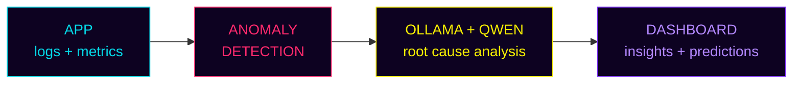

<div align="center">


<br/>

<a href="https://www.linkedin.com/in/aditya-shukla-606a40415"></a>
<a href="https://github.com/adityx-lab"></a>


</div>

<br/>

```text
 ┌─────────────────────────────────────────────────────────────┐
 │  NEURAL LINK v2.0 ............................... [  OK  ]  │
 │  LOADING OPERATOR: ADITYA_SHUKLA ................ [  OK  ]  │
 │  CORE LANGUAGE: JAVA ............................ [  OK  ]  │
 │  LOCAL LLM RUNTIME (OLLAMA) ..................... [  OK  ]  │
 │  COFFEE ......................................... [ LOW!  ]  │
 │  MISSION: BUILD INTELLIGENT SYSTEMS ............. [ ACTIVE ] │
 └─────────────────────────────────────────────────────────────┘
```


| FIELD | DATA |
|:--|:--|
| **HANDLE** | `adityx-lab` |
| **NAME** | Aditya Shukla |
| **ORIGIN** | Kanpur, India |
| **FACTION** | B.Tech CSE, PSIT Kanpur (Final Year) |
| **CLASS** | Full Stack Developer / AI Integrator |
| **MAIN WEAPON** | Java |
| **SPECIALS** | MERN, local LLMs, TensorFlow.js, DSA |
| **CREED** | *Build. Break. Debug. Repeat.* |
| **CURRENT STATUS** | 🟢 Open to SDE / Backend / Full Stack internships |

<br/>


### ▌MISSION 001 — `TRACESAGE`
**AI Root Cause Analysis & Predictive Monitoring** &nbsp;   

> Apps break. TraceSage tells you **why**, in plain English, and warns you before it happens again.



- 🔍 Application monitoring and anomaly detection
- 🧠 AI-written root cause explanations via **Ollama + Qwen**, running locally
- 🔮 Predictive analysis to flag trouble before it becomes an outage

    

<br/>

### ▌MISSION 002 — `FITX`
**Virtual Fitness Coach** &nbsp; 

> A personal AI coach plus a camera that checks your form in real time.

- 🎥 **Live form analysis** with TensorFlow.js MoveNet: Squats, Lunges, Curls, Overhead Press, Plank
- 🧬 **Custom AI coach**: Qwen2.5 fine-tuned with **LoRA**, served locally through Ollama
- 🔐 **Full backend**: Node.js, Express, MongoDB, JWT auth
- 📊 Workout and nutrition tracking in a single-page app

   

[](https://github.com/adityx-lab/FitX)

<br/>

### ▌MISSION 003 — `SVMS`
**Smart Vehicle Monitoring System** &nbsp; 

> Where the vehicle is, how much fuel it has, and how it's being driven. Live.

- 📡 GPS-based real-time vehicle tracking
- ⛽ Fuel monitoring
- 🚦 Driver behaviour analysis

[](https://github.com/motordeath/vms)

<br/>

### ▌MISSION 004 — `MISSION-DSA`
**Placement Prep, in Public** &nbsp; 

> Every LeetCode / HackerRank solution, sorted by topic: Arrays, Strings, Linked Lists, Trees, Graphs, DP, Stacks, Queues, Heaps.

[](https://github.com/adityx-lab/mission-dsa)

<br/>


<div align="center">

**`LANGUAGES`**<br/>


**`FRONTEND + BACKEND`**<br/>


**`DATA + TOOLS`**<br/>


**`AI / ML`**<br/>


</div>

<br/>


<div align="center">


</div>

<br/>


```diff
+ Has shipped AI features end to end: LoRA fine-tuning, local LLM inference, in-browser pose detection
+ Full stack across the MERN stack, with strong Java and DSA fundamentals
+ Builds first, reads the docs second, and finishes what he starts
- Not looking for a role where nobody ships anything
```

<div align="center">

**Seeking:** paid SDE / Backend / Full Stack internship &nbsp;•&nbsp; **Location:** India (open to remote)

[](https://www.linkedin.com/in/aditya-shukla-606a40415)

</div>

<br/>

<div align="center">

```text
> CONNECTION ESTABLISHED.
> THE SYSTEM IS NEVER FINISHED.
> _
```


</div>
